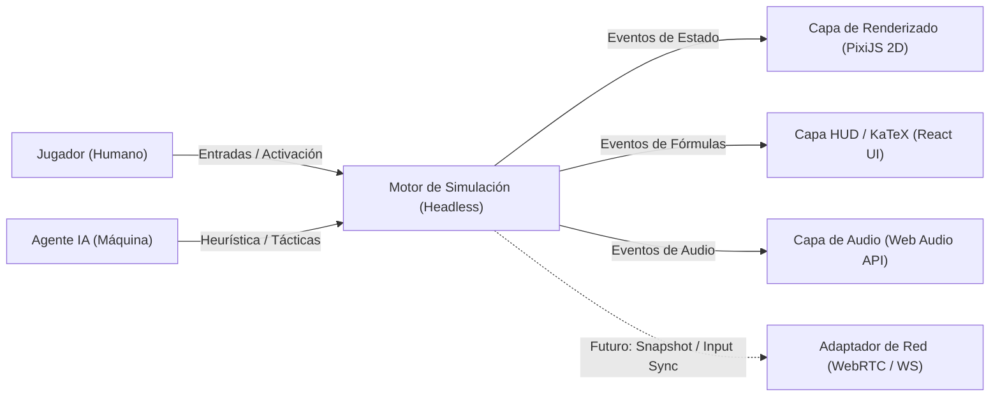
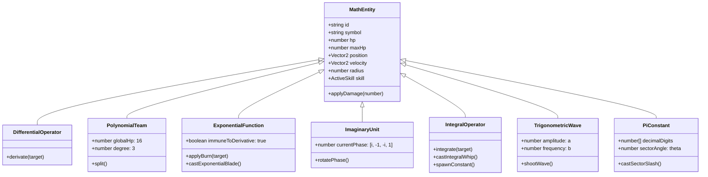
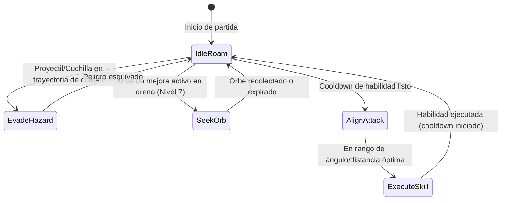
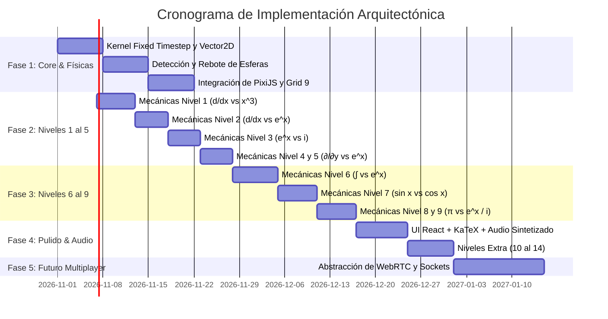

# Propuesta de Arquitectura de Software: Math vs Math (Mathematical Combat Simulator)

**Documento:** Propuesta de Arquitectura de Software de Alto Nivel y Especificación Técnica  
**Autor:** Senior Software & Game Architect  
**Versión:** 1.0.0  
**Fecha:** Octubre 2026  
**Estado:** Propuesta Formal para Implementación  

---

## 1. Resumen Ejecutivo y Visión del Producto

### 1.1. Visión del Sistema
**Math vs Math** es un videojuego web 2D de acción y simulación estratégica en tiempo real basado en conceptos de cálculo diferencial e integral, análisis complejo, trigonometría y álgebra. Dos entidades matemáticas (operadores, funciones o constantes) se enfrentan en una arena cartesiana bidimensional cerrada (relación de aspecto móvil vertical 9:16), combinando dinámicas físicas de colisión elástica continua con ataques especiales basados en el trazado visual de curvas y fórmulas matemáticas.

Actualmente, el alcance inicial se centra en una experiencia **Jugador vs. Máquina (IA)** altamente responsiva, fluida y sin fricción de instalación (basada en navegadores web modernos). La arquitectura está diseñada desde sus cimientos para garantizar una evolución transparente y sin reescritura hacia un modo **Multijugador en Tiempo Real (1v1 P2P / Cliente-Servidor)** en fases posteriores.



---

## 2. Análisis de Trade-Offs y Priorización de Atributos Arquitectónicos

Como arquitecto de software, cada decisión de diseño técnico implica una renuncia explícita (*trade-off*). A continuación se formaliza la priorización de los atributos de calidad (según norma ISO/IEC 25010 y metodología ATAM - *Architecture Tradeoff Analysis Method*) adaptada a las necesidades presentes y futuras del proyecto.

```
       [TIER 1: MÁXIMA PRIORIDAD]
       ├── Determinismo de Simulación (Simulation Determinism)
       ├── Desacoplamiento Lógico/Visual (Modularity & Decoupling)
       └── Rendimiento en Cliente (60-120 FPS / Low Frame Budget)
                           ▲
                           │ Priorizado sobre
                           ▼
       [TIER 2: PRIORIDAD SECUNDARIA / DIFERIDA]
       ├── Complejidad de Infraestructura Backend (Serverless / Static Hosting)
       ├── Persistencia Distribuida (Local-First State)
       └── Fidelidad de Motor Físico Pesado (Lightweight Custom Math Physics)
```

### 2.1. Atributos Priorizados (Tier 1)

1. **Determinismo y Desacoplamiento Lógico (*Simulation Determinism & Modularity*):**
   * **Decisión:** El bucle de física, las matemáticas y el estado de la partida se ejecutan en un núcleo *headless* completamente desacoplado del DOM y de la API gráfica (WebGL/Canvas). Utiliza un bucle de tiempo fijo (*Fixed Timestep Accumulator Loop* a 60 Hz).
   * **Trade-off asumido:** Mayor sobrecarga inicial de código (*boilerplate*). No se permite mutar *sprites* directamente en las colisiones; en su lugar, se utilizan estructuras de datos inmutables y un despachador de eventos / acciones.
   * **Beneficio fundamental:** Garantiza que la lógica del juego sea 100% reproducible y testeable con pruebas unitarias rápidas. Además, es la **única forma** de permitir que en el futuro el mismo núcleo de simulación corra en un servidor Node.js o en un WebWorker para reconciliación multijugador (*Rollback / Client-Side Prediction*).

2. **Rendimiento en Cliente y Presupuesto de Frame (*Client Performance & Low Frame Latency*):**
   * **Decisión:** Garantizar 60–120 FPS estables incluso en dispositivos móviles gama media con hasta 50 entidades en pantalla (por ejemplo, en las proliferaciones de la Integral con polinomios de grado 7). Se implementa *Object Pooling* y *Batch Rendering*.
   * **Trade-off asumido:** Se descarta el renderizado puro mediante SVG o DOM/CSS para la arena, y se prioriza WebGL/WebGPU mediante PixiJS con reciclado de memoria para evitar pausas por Garbage Collection (GC).

3. **Extensibilidad de Reglas Matemáticas (*Extensibility via Open-Closed Principle*):**
   * **Decisión:** Las mecánicas no se programan con sentencias `switch/case` kilométricas. Se implementa un motor de interacción basado en el patrón **Strategy + Data-Driven Rule Engine**, donde cada operador y función declara sus propiedades algebraicas (conmutatividad, reglas de derivación, inmunidades, fases periódicas).
   * **Trade-off asumido:** Curva de abstracción inicial más elevada para los desarrolladores.

### 2.2. Atributos Sacrificados o Postergados Conscientemente (Tier 2 y 3)

1. **Infraestructura Backend Compleja (Postergado a Fase Multijugador):**
   * Para la versión Single-Player vs. IA no se desplegará una infraestructura de microservicios ni servidores dedicados de juego. Todo el juego se entrega como una SPA (*Single Page Application*) estática distribuida globalmente por una CDN Edge (Cloudflare Pages / Vercel), reduciendo el costo de operación a casi cero.
2. **Persistencia Centralizada con Cuentas de Usuario:**
   * El progreso de niveles, puntuaciones y configuraciones se almacena en el cliente vía `IndexedDB` y `localStorage`. No se añade autenticación (OAuth/JWT) ni bases de datos SQL/NoSQL en esta fase.
3. **Motores de Física Pesados de Terceros (Box2D, Matter.js):**
   * **Trade-off:** Esos motores consumen cientos de kilobytes, calculan fricciones, momentos de inercia y polígonos complejos que no se requieren aquí. Nuestro dominio requiere física elástica euclidiana pura en 2D (esferas y bordes AABB) combinada con ecuaciones matemáticas analíticas para curvas y láseres. Se adopta un núcleo físico matemático a medida, ultra-liviano, determinista y de tamaño despreciable (< 5 KB).

---

## 3. Matriz de Tecnologías Recomendadas

A continuación se detalla la selección del stack tecnológico para la aplicación web, evaluando alternativas y sustentando la elección final:

| Componente | Tecnología Seleccionada | Alternativas Evaluadas | Justificación del Arquitecto |
| :--- | :--- | :--- | :--- |
| **Lenguaje Core** | **TypeScript (Strict Mode)** | JavaScript (ESNext), Rust (Wasm) | Tipado estricto imprescindible para vectores 2D, estados de entidades, matrices de colisión y fórmulas. Rust/Wasm añade complejidad innecesaria para un juego 2D con < 100 entidades. |
| **Motor Gráfico de Arena** | **PixiJS v8 (WebGL 2 / WebGPU)** | Phaser 3, Three.js, Canvas2D Nativo | PixiJS es el estándar de la industria para renderizado 2D de ultra-alto rendimiento. Soporta *batching* automático, efectos de resplandor (*glow filters*), partículas y renderizado de mallas vectoriales para curvas continuas. Phaser es demasiado monolítico; Canvas2D nativo sufre con +40 partículas y lásers. |
| **Capa de Interfaz (HUD & Menús)** | **React 19 + TailwindCSS** | Svelte 5, Vue 3, DOM Vanilla | React permite un ecosistema maduro para la gestión de menús, configuraciones, selección de niveles y HUD desacoplado. TailwindCSS permite diseñar una interfaz estética con temática matemática y futurista. |
| **Renderizado de Fórmulas Matemáticas** | **KaTeX** | MathJax, MathLive, Imágenes estáticas | KaTeX compila expresiones LaTeX matemáticas sincrónicamente y a velocidad supersónica (hasta 100x más rápido que MathJax), permitiendo textos flotantes reactivos como $\frac{d}{dx}(x^3)=3x^2$ o $\frac{\partial}{\partial y}(e^x)=0$ sin caídas de frame. |
| **Motor de Audio / SFX** | **Web Audio API Sintetizado + Howler.js** | Howler.js únicamente, Audio HTML5 nativo | Permite sintetizar sonidos de estilo retro (pitidos de cuenta regresiva, pulsos de láser, ruidos blancos de impacto y acordes de victoria) proceduralmente con osciladores Web Audio, complementado con Howler para música de fondo. Cero megabytes de descarga de audio obligatoria. |
| **Gestor de Estado y Eventos** | **Zustand + Tiny-Emitter (Custom EventBus)** | Redux Toolkit, MobX | Zustand ofrece almacenamiento reactivo ultraligero y sin *boilerplate* para el HUD. Un EventBus tipado conecta el núcleo del juego con el HUD sin acoplamiento directo. |
| **Herramientas de Build & Testing** | **Vite + Vitest** | Webpack, Jest | Vite ofrece HMR instantáneo. Vitest ejecuta pruebas unitarias ultra-rápidas para verificar formalmente las reglas matemáticas y la física sin necesidad de abrir un navegador. |

---

## 4. Arquitectura de Software del Sistema

Se adopta una **Arquitectura Hexagonal (Puertos y Adaptadores) combinada con Arquitectura Orientada a Datos (Data-Oriented Design / ECS simplificado)**:

```
┌────────────────────────────────────────────────────────────────────────┐
│                        CAPA DE PRESENTACIÓN (UI)                       │
│   ┌──────────────────────────────┐  ┌──────────────────────────────┐   │
│   │   HUD & Modales (React/DOM)  │  │   KaTeX Formula Renderer     │   │
│   └──────────────▲───────────────┘  └──────────────▲───────────────┘   │
└──────────────────┼─────────────────────────────────┼───────────────────┘
                   │ Eventos                         │ Notificaciones
┌──────────────────┼─────────────────────────────────┼───────────────────┐
│                  ▼                                 │                   │
│   ┌────────────────────────────────────────────────┴───────────────┐   │
│   │              ADAPTADOR GRÁFICO (PIXI.JS RENDERER)              │   │
│   │   - Grid cartesiano con subdivisiones                          │   │
│   │   - Curvas paramétricas, láseres y halos neón                  │   │
│   │   - Interpolación de movimiento: Pos = Lerp(Prev, Curr, alpha) │   │
│   └────────────────────────────────▲───────────────────────────────┘   │
└────────────────────────────────────┼───────────────────────────────────┘
                                     │ Lee estado (Read-Only Snapshots)
┌────────────────────────────────────┴───────────────────────────────────┐
│                     NÚCLEO DE SIMULACIÓN (HEADLESS)                    │
│                                                                        │
│   ┌────────────────────────────────────────────────────────────────┐   │
│   │                      Fixed Timestep Loop                       │   │
│   │            (Accumulator: dt = 1/60s = 16.666 ms)               │   │
│   └──────┬─────────────────────────┬─────────────────────────┬─────┘   │
│          │                         │                         │         │
│          ▼                         ▼                         ▼         │
│   ┌───────────────┐         ┌───────────────┐         ┌──────────────┐ │
│   │ Motor Físico  │         │ Motor Reglas  │         │ Máquina IA   │ │
│   │ (Colisión 2D, │         │ Matemáticas   │         │ (Heurística, │ │
│   │  Rebotes)     │         │ (Efectos, DoT)│         │  Cooldowns)  │ │
│   └──────┬────────┘         └──────┬────────┘         └──────┬───────┘ │
│          │                         │                         │         │
│          └────────────────► ┌──────┴───────┐ ◄───────────────┘         │
│                             │ Estado Mundo │                           │
│                             │ (World State)│                           │
│                             └──────────────┘                           │
└────────────────────────────────────────────────────────────────────────┘
```

### 4.1. Módulos Fundamentales

1. **`MathGameEngine` (Core Kernel):**
   * Administra el bucle de simulación con paso de tiempo fijo (`FIXED_TIMESTEP = 1 / 60`).
   * No contiene referencias a `window`, `document`, ni a objetos `PIXI.Sprite`.
   * Expone métodos: `init(levelConfig)`, `step(dt, inputs)`, `getStateSnapshot()`, `on(event, handler)`.

2. **`MathPhysicsEngine`:**
   * Detección y resolución de colisiones continuas elásticas entre esferas (conservación de cantidad de movimiento lineal).
   * Colisión y rebote cinemático contra bordes de la arena cartesiana ($x \in [-X_{\max}, X_{\max}]$, $y \in [-Y_{\max}, Y_{\max}]$).
   * Algoritmos analíticos de intersección:
     * **Círculo vs. Curva Polinómica:** $y - y_0 = a(x - x_0)^n$.
     * **Círculo vs. Curva Exponencial:** $y - y_0 = e^{x - x_0}$.
     * **Círculo vs. Onda Sinusoidal:** $y - y_0 = a \sin(b(x - x_0))$.
     * **Círculo vs. Sector Circular:** Intersección de radio y apertura angular $\theta$.

3. **`MathRulesEngine` (Motor de Interacción Matemática):**
   * Modela la semántica algebraica del enfrentamiento:
     * Operador vs. Función.
     * Operador vs. Operador.
     * Función vs. Función.
   * Resuelve efectos de estado: *Burn* (Quemadura DoT), *Phase Rotation* (Ciclos de $i$), *Proliferation* (Integración indefinida).

4. **`AIAgent` (Controlador de la Máquina):**
   * Evalúa la posición relativa del oponente, tiempos de recarga de habilidades y proyectiles entrantes.
   * Emula el comportamiento observado en las simulaciones de referencia: activación precisa de habilidades según ventanas de oportunidad y cooldowns.

5. **`PixiViewAdapter`:**
   * Mapea el estado matemático abstracto a primitivas visuales de PixiJS.
   * Realiza **interpolación de renderizado (`alpha = accumulator / dt`)** para conseguir suavidad visual absoluta sin importar la tasa de refresco del monitor (60Hz, 120Hz, 144Hz, 240Hz).

---

## 5. Especificación Completa de Niveles y Mecánicas

A continuación se consolidan formalmente los **9 niveles descritos en los requisitos originales**, complementados con sus valores numéricos y reglas de combate, seguidos de **5 niveles adicionales inéditos** que amplían el universo matemático del juego.

### 5.1. Niveles Originales Garantizados (1 al 9)



#### Nivel 1: Operador Diferencial ($\frac{d}{dx}$) vs. Polinomio ($x^3$)
* **Entidades:**
  * **$\frac{d}{dx}$ (Cian `#00ACC1`):** HP `100/100`. Movimiento elástico continuo.
  * **Equipo Polinómico (Naranja `#F4511E`):** HP global `16/16`. Se subdivide por grado:
    * Grado 3 ($x^3$): 1 esfera grande. Al colisionar con $\frac{d}{dx}$, aplica $\frac{d}{dx}(x^3)=3x^2$ y se divide en 3 esferas de $x^2$.
    * Grado 2 ($x^2$): Al recibir derivada $\frac{d}{dx}(x^2)=2x$, se divide en 2 esferas de $x$.
    * Grado 1 ($x$): Al recibir derivada $\frac{d}{dx}(x)=1$, se transforma en esfera de grado 0 ($1$).
    * Grado 0 ($1$): Al colisionar, $\frac{d}{dx}(1)=0$, provocando su destrucción absoluta.
* **Ataque Activo Polinomio ("Invocación de Gráfico"):**
  * Cooldown de 3 a 4s.
  * *Telegrafiado (0.8s):* Trazado de curvas de cada esfera ($x^3$ cúbica, $x^2$ parábola, $x$ recta a 45°, $1$ recta horizontal).
  * *Disparo:* Lásers que siguen a las esferas. Daño a $\frac{d}{dx}$: Láser $x^2$ = -23 HP; Láser $x/1$ = -18 HP.
* **Condición de Victoria:** Reducir el HP global naranja a `0/16`.

#### Nivel 2: Operador Diferencial ($\frac{d}{dx}$) vs. Función Exponencial ($e^x$)
* **Entidades:**
  * **$\frac{d}{dx}$:** HP `100/100`.
  * **$e^x$ (Rojo `#D32F2F`):** HP `80/80`.
* **Mecánica Pasiva de Inmunidad:** $\frac{d}{dx}(e^x) = e^x$. La colisión física no causa daño a $e^x$; despliega un escudo hexagonal rojo giratorio con texto $\frac{d}{dx}e^x = e^x$ e incrementa el contador de intentos fallidos.
* **Mecánica de Quemadura por Contacto (DoT):** El choque incendia a $\frac{d}{dx}$ con daño inicial de -4 HP y ticks continuos de -2 HP.
* **Ataque Activo $e^x$ ("Cuchilla Exponencial"):**
  * Cooldown de 3 a 4s. Traza la curva $y - y_0 = e^{x - x_0}$ con asíntota punteada inferior.
  * Daño directo al impactar a $\frac{d}{dx}$: -10 a -13 HP, reactivando o renovando la quemadura.
* **Condición de Victoria:** Sobrevivir y eliminar a $\frac{d}{dx}$ llevándola a `0/100` HP.

#### Nivel 3: Función Exponencial ($e^x$) vs. Unidad Imaginaria ($i$)
* **Entidades:**
  * **$e^x$:** HP `80/80`. Ataque con Cuchilla Exponencial y Quemadura.
  * **$i$ (Magenta `#D81B60`):** HP `50/50`.
* **Mecánica Cíclica de Potencias ($i \times i = -1$):** Cada 3 segundos rota de fase:
  1. **Fase $i$ (Perforación):** Esfera intangible. Atraviesa a $e^x$ e inflige -8 HP por penetración.
  2. **Fase $-1$ (Reflexión):** Multiplica el daño entrante por $-1$. Refleja la quemadura y los cortes de la Cuchilla devolviendo proyectiles de -16 a -20 HP a $e^x$.
  3. **Fase $-i$ (Perforación + Reflexión):** Combina el daño por contacto (-8 HP) y el reflejo de ataques recibidos.
  4. **Fase $1$ (Normal):** Colisión elástica estándar sin propiedades especiales.
* **Condición de Victoria:** Coordinar las fases defensivas y ofensivas para agotar la vida del oponente.

#### Nivel 4: Derivada Parcial ($\frac{\partial}{\partial y}$) vs. Función Exponencial ($e^x$)
* **Entidades:**
  * **$\frac{\partial}{\partial y}$ (Verde Esmeralda `#00897B`):** HP `100/100`.
  * **$e^x$:** HP `80/80`.
* **Mecánica de Aniquilación Letal (One-Shot):**
  * Al tratarse de una función en $x$, la derivada respecto a $y$ evalúa la variable como constante: $\frac{\partial}{\partial y}(e^x) = 0$.
  * La colisión directa de $\frac{\partial}{\partial y}$ contra $e^x$ inflige un golpe crítico mortal inmediato de **-80 HP**, destruyendo a $e^x$ en el acto.
* **Dinámica de Combate:** $e^x$ debe evadir el contacto directo mediante maniobras evasivas y liquidar a $\frac{\partial}{\partial y}$ a distancia usando la Cuchilla Exponencial antes de ser alcanzado.

#### Nivel 5: Derivada Parcial Avanzada ($\frac{\partial}{\partial y}$) vs. Exponencial Compuesta ($e^{xy}$)
* *(Extensión y refinamiento sobre la variante 5.md descrita en las especificaciones base)*
* **Entidades:**
  * **$\frac{\partial}{\partial y}$:** HP `100/100`.
  * **$e^{xy}$:** HP `90/90`.
* **Mecánica:** Regla de la cadena multivariable: $\frac{\partial}{\partial y}(e^{xy}) = x \cdot e^{xy}$.
  * En lugar de morir instantáneamente, el impacto genera una esfera multiplicadora $x$ que orbita a $e^{xy}$, la cual reduce el impacto de la aniquilación a -30 HP por colisión, obligando a un duelo táctico de posicionamiento relativo en los cuadrantes del plano cartesiano.

#### Nivel 6: Operador Integral ($\int$) vs. Función Exponencial ($e^x$)
* **Entidades:**
  * **$\int$ (Naranja Ámbar `#FB8C00`):** HP `80/80`. Posee un apéndice curvo orbital en forma de signo integral.
  * **$e^x$:** HP `80/80`.
* **Mecánicas:**
  1. **Integración Indefinida:** Al chocar contra $e^x$, $\int e^x dx = e^x + C_n$. No daña a $e^x$, sino que engendra una esfera constante aliada $C_n$ (1 HP).
  2. **Proliferación Polinómica:** Al chocar $\int$ contra una esfera aliada $C_n x^k$, la eleva de grado: $\int C_n x^k dx = \frac{C_n}{k+1} x^{k+1} + C_m$, generando otra constante $C_m$.
  3. **Lluvia de Láseres:** Cada esfera aliada dispara láseres con su forma polinómica (-4 a -8 HP a $e^x$).
  4. **Látigo Integral (`[∫ 채찍!]`):** Cooldown de 5s; ataque a corta distancia que inflige -12 HP y engendra un nuevo $C_n$.
  5. **Cuchilla Exponencial de $e^x$:** Corta y limpia las constantes $C_n$ al instante (-1 HP), dañando y quemando a $\int$.

#### Nivel 7: Duelo Trigonométrico: Seno ($\sin x$) vs. Coseno ($\cos x$)
* **Entidades:**
  * **$\sin x$ (Azul Índigo `#3F51B5`):** HP `100/100`. Ecuación base: $y = a \sin(bx)$.
  * **$\cos x$ (Magenta Púrpura `#D500F9`):** HP `100/100`. Ecuación base: $y = a \cos(bx)$.
* **Orbes Potenciadores en la Arena:**
  * **`a × 2` (Amplitud):** Duplica $a$ ($1 \rightarrow 2 \rightarrow 4 \rightarrow 8 \rightarrow 16$). Incrementa el ancho del área de impacto de la onda disparada.
  * **`b × 2` (Frecuencia Angular / Período):** Duplica $b$. El período de recarga se rige por $T = \frac{2\pi}{b}$ ($6.28\text{s} \rightarrow 3.14\text{s} \rightarrow 1.57\text{s} \rightarrow 0.78\text{s} \rightarrow 0.39\text{s}$). A mayor $b$, disparos de onda ultrarrápidos.
* **Ataque de Onda Seno/Coseno:** Dispara un proyectil ondulatorio hacia el rival a lo largo de una línea directriz, infligiendo -25 HP por impacto.

#### Nivel 8: Función Exponencial ($e^x$) vs. Constante Pi ($\pi$)
* **Entidades:**
  * **$e^x$:** HP `80/80`.
  * **$\pi$ (Azul Real `#1E88E5`):** HP `75/75`.
* **Ataques de $\pi$:**
  1. **Cola Orbital Decimal ($3.14159265\dots$):** Dígitos flotantes en rotación orbital. El contacto pasivo con el dígito activo resta vida equivalente al valor del número (-3, -1, -4, etc.) y avanza al siguiente decimal de $\pi$.
  2. **Corte de Sector Circular (`부채꼴 베기!`):**
     * Fórmula: $S = \frac{1}{2} r^2 \theta$.
     * Daño directo de -15 HP.
     * En cada activación, el sector angular $\theta$ se expande: $\frac{\pi}{6} \rightarrow \frac{\pi}{3} \rightarrow \frac{\pi}{2} \rightarrow \pi \rightarrow 2\pi$. Al alcanzar $2\pi$ cubre un círculo completo protector alrededor de $\pi$, antes de resetearse.

#### Nivel 9: Unidad Imaginaria ($i$) vs. Constante Pi ($\pi$)
* **Entidades:**
  * **$i$:** HP `50/50`. Con rotación cíclica de 4 fases ($i$, $-1$, $-i$, $1$).
  * **$\pi$:** HP `75/75`. Con cola decimal orbital y sector angular expansivo.
* **Dinámica:** Duelo de titanes preliminar a la Identidad de Euler. $i$ utiliza estados de intangibilidad y reflexión para sobrevivir a los sectores gigantes de $\pi$ y contraatacar en las fases negativas.

---

### 5.2. Nuevos Niveles Propuestos (Ampliación Arquitectónica)

Para potenciar la rejugabilidad y profundidad matemática, se diseñan las siguientes 5 mecánicas y niveles adicionales:

```
Nivel 10: Gran Final de Euler (e^(i·π) + 1 = 0)
Nivel 11: Logaritmo Natural (ln x) vs. Singularidad de asíntota
Nivel 12: Regla de L'Hôpital (Límite 0/0)
Nivel 13: Transformación Matricial (Rotación y Deformación del Espacio)
Nivel 14: Delta de Dirac (δ(x)) y el Impulso Infinito
```

#### Nivel 10: La Identidad de Euler ($e^{i\pi} + 1 = 0$) - Combate de Jefes Multietapa
* **Entidades:**
  * **Jugador:** $e^{i\theta}$ (Fasor en el círculo unitario).
  * **Jefe:** Entidad Dual $\pi$ y Operador $\frac{d}{dx}$.
* **Mecánica:** A medida que $\theta$ avanza con el tiempo, la entidad oscila entre componentes real e imaginaria según la fórmula de Euler:
  $$e^{i\theta} = \cos \theta + i \sin \theta$$
* Cuando $\theta = \pi$, la entidad alcanza $e^{i\pi} = -1$. Al colisionar con la constante $+1$ que aparece en el centro de la arena, se activa una onda de aniquilación armónica total que limpia los proyectiles enemigos.

#### Nivel 11: Logaritmo Natural ($\ln x$) vs. Potencia Cúbica ($x^3$)
* **Mecánica de Singularidad:** Para $x \le 0$, el lado izquierdo del plano cartesiano se convierte en una zona de distorsión gravitatoria (asíntota vertical en $x=0$).
* **Derivada:** Al colisionar $\frac{d}{dx}$ con $\ln x$, se produce una onda de hiperbolización $\frac{1}{x}$ que desacelera violentamente a los proyectiles en pantalla.

#### Nivel 12: Regla de L'Hôpital ($\lim_{x \to 0} \frac{\sin x}{x}$)
* **Mecánica:** La arena genera una zona de indeterminación matemática de tipo $\frac{0}{0}$. Ambas entidades sufren atenuación si entran en la zona indeterminada hasta que se activa la habilidad de "L'Hôpital", derivando simultáneamente numerador y denominador para restaurar el valor numérico $1$ y otorgar un escudo de energía.

#### Nivel 13: Transformación Lineal / Matriz ($M \in \mathbb{R}^{2\times 2}$)
* **Mecánica:** La entidad matricial no dispara proyectiles convencionales; periódicamente aplica una matriz de transformación sobre el plano cartesiano:
  $$\begin{bmatrix} x' \\ y' \end{bmatrix} = \begin{bmatrix} \cos \alpha & -\sin \alpha \\ \sin \alpha & \cos \alpha \end{bmatrix} \begin{bmatrix} x \\ y \end{bmatrix}$$
* La cuadrícula y las trayectorias de las esferas rotan y se comprimen según los autovalores (*eigenvalues*) de la matriz activa.

#### Nivel 14: Delta de Dirac ($\delta(x)$) vs. Función Escalón de Heaviside ($H(x)$)
* **Mecánica:** La Delta de Dirac permanece invisible con radio casi cero hasta que colisiona o se activa: libera un pulso instantáneo de amplitud teórica infinita ($\int \delta(x)dx = 1$), provocando un retroceso elástico de alta velocidad en todos los cuerpos circundantes.

---

## 6. Modelo de Control del Jugador y Motor de Inteligencia Artificial

### 6.1. Esquema de Control (Player Interaction Model)
En el diseño actual (1 Jugador vs. IA), el jugador controla activamente a la entidad de la izquierda o derecha según el nivel:
1. **Física Semi-Guiada (Nudge / Impulso):**
   * Las esferas tienen inercia y rebote elástico continuo. El jugador puede utilizar controles táctiles (arrastre con dedo / puntero del ratón) para aplicar pequeños vectores de aceleración ("micro-impulsos") y esquivar o buscar colisiones.
2. **Activación de Habilidades Tácticas:**
   * Botón de habilidad con indicador de recarga (*cooldown ring*).
   * Teclas de acceso rápido: `Barra Espaciadora` o toque sobre el botón en el HUD inferior para detonar la habilidad cargada (ej. `[그래프 소환!]`, `[지수 칼날!]`, `[부채꼴 베기!]`).
   * Puntería de habilidades directas (como las ondas $\sin x$ / $\cos x$): se orientan dinámicamente hacia la posición actual del rival o mediante arrastre del ángulo de tiro.

### 6.2. Motor de IA del Oponente (Heuristic Tactical Agent)
El agente de IA implementa un autómata finito determinista con heurísticas basadas en distancia e intercepción vectorial:



1. **Predicción de Colisión:** La IA calcula mediante producto punto y discriminante cuadrático si un láser o cuchilla intersectará su radio en los próximos $t \le 0.8\text{s}$. Si la probabilidad de impacto es alta, aplica un impulso perpendicular para salir del haz.
2. **Disparo Oportunista:** Al llegar su cooldown a cero, la IA evalúa la posición del jugador. Por ejemplo, en el nivel de $e^x$, la IA aguarda a que el jugador se encuentre alineado con la trayectoria de la curva exponencial antes de activar la "Cuchilla Exponencial".

---

## 7. Hoja de Ruta Hacia el Multijugador (Roadmap to Multiplayer)

Para cumplir con la premisa de no reescribir código cuando se implemente el modo multijugador, la arquitectura establece desde el primer día las siguientes fronteras de diseño:

```
                    MODO SINGLE-PLAYER (ACTUAL)
  ┌─────────────────────────────────────────────────────────────┐
  │ Local Player Input ────┐                                    │
  │                        ▼                                    │
  │ Local AI Agent ──────► CommandQueue ──► Headless Simulation │
  └─────────────────────────────────────────────────────────────┘

                    MODO MULTIJUGADOR (FUTURO)
  ┌─────────────────────────────────────────────────────────────┐
  │ Local Player Input ──┐                                      │
  │                      ▼                                      │
  │ WebRTC DataChannel ──► CommandQueue ──► Headless Simulation │
  │ (Remote Inputs)                                             │
  └─────────────────────────────────────────────────────────────┘
```

1. **Protocolo de Comandos Serializables:**
   * Ninguna entrada física o de habilidad muta el estado directamente. Todas las acciones se empaquetan en estructuras JSON/ArrayBuffer discretas:
   ```typescript
   interface PlayerActionCommand {
     tick: number;
     entityId: string;
     actionType: 'ACTIVATE_SKILL' | 'APPLY_IMPULSE';
     payload: { angle?: number; power?: number };
   }
   ```
2. **Simulación Determinista:**
   * Toda la aritmética de números pseudoaleatorios (para la aparición de orbes amarillos o rebotes con ligera perturbación) utiliza un generador basado en semilla determinista (*Seeded PRNG* como Xoshiro128 o Mulberry32). Dos clientes con la misma semilla y las mismas acciones obtendrán **exactamente el mismo estado en cada tick**.
3. **Estrategia de Red Recomendada:**
   * **WebRTC DataChannels (P2P Mesh para 1v1):** Latencia ultra-baja sin costo de servidores de retransmisión (únicamente servidor de señalización STUN/TURN liviano).
   * Arquitectura **Lockstep determinista con interpolación** o **Client-Side Prediction con Rollback** para compensar fluctuaciones de ping.

---

## 8. Estructura de Archivos del Proyecto

La siguiente estructura modular refleja la separación estricta de responsabilidades en el código fuente:

```
math-vs-math/
├── index.html
├── package.json
├── tsconfig.json
├── vite.config.ts
├── tailwind.config.js
│
├── src/
│   ├── main.tsx                         # Entry point de la aplicación React
│   │
│   ├── core/                            # NÚCLEO HEADLESS (Zero dependencias de render/DOM)
│   │   ├── engine/
│   │   │   ├── GameLoop.ts              # Bucle de paso fijo (Fixed Timestep Accumulator)
│   │   │   ├── SimulationEngine.ts      # Orquestador del estado y ciclo de vida de la partida
│   │   │   └── EventBus.ts              # Bus de eventos tipado
│   │   ├── physics/
│   │   │   ├── Vector2D.ts              # Operaciones vectoriales inmutables
│   │   │   ├── CollisionDetector.ts     # Detección círculo-círculo, círculo-línea, círculo-curva
│   │   │   └── ElasticSolver.ts         # Resolución cinemática de choques y rebotes
│   │   ├── math/
│   │   │   ├── Curves.ts                # Ecuaciones paramétricas (polinomios, e^x, sin/cos)
│   │   │   ├── RulesMatrix.ts           # Definición algebraica de colisiones y derivadas
│   │   │   └── PRNG.ts                  # Generador determinista de números pseudoaleatorios
│   │   ├── entities/
│   │   │   ├── BaseEntity.ts            # Entidad base con transform, vida y cooldown
│   │   │   ├── DifferentialOperator.ts  # Implementación de d/dx y ∂/∂y
│   │   │   ├── PolynomialEntity.ts      # Implementación de x^n, división y HP global
│   │   │   ├── ExponentialEntity.ts     # Implementación de e^x, quemadura y cuchilla
│   │   │   ├── ImaginaryEntity.ts       # Implementación de i y rotación de fases
│   │   │   ├── IntegralEntity.ts        # Implementación de ∫, látigo y proliferación
│   │   │   ├── TrigEntity.ts            # Implementación de sin(x) y cos(x) con orbes
│   │   │   └── PiEntity.ts              # Implementación de π, cola decimal y sectores
│   │   ├── ai/
│   │   │   ├── AIAgent.ts               # Máquina de estados táctica para el oponente
│   │   │   └── TacticalHeuristics.ts    # Algoritmos de evasión y puntería
│   │   └── levels/
│   │       ├── LevelRegistry.ts         # Catálogo de niveles (1 al 14)
│   │       └── LevelConfig.ts           # Interfaz de configuración de cada nivel
│   │
│   ├── render/                          # CAPA DE RENDERIZADO GRÁFICO (PIXI.JS)
│   │   ├── PixiStage.ts                 # Canvas WebGL/WebGPU y control de viewport 9:16
│   │   ├── CartesianGrid.ts             # Renderizado de ejes graduados, origen y cuadrícula
│   │   ├── EntityRenderer.ts            # Gráficos de esferas, auras de neón y halos
│   │   ├── CurveLaserRenderer.ts        # Renderizado de curvas matemáticas y haces láser
│   │   ├── ParticleSystem.ts            # Sistema de partículas para colisiones y DoT de fuego
│   │   └── Interpolator.ts              # Suavizado de posiciones entre ticks de física
│   │
│   ├── audio/                           # CAPA DE AUDIO Y EFECTOS
│   │   ├── WebAudioSynth.ts             # Generación de pitidos retro y ruidos con osciladores
│   │   └── SoundManager.ts              # Gestor de pistas, fanfarrias y volumen
│   │
│   ├── ui/                              # CAPA DE INTERFAZ DE USUARIO (REACT + TAILWIND)
│   │   ├── components/
│   │   │   ├── HeaderHUD.tsx            # Avatares circulares, nombres y etiqueta "VS"
│   │   │   ├── HPBar.tsx                # Barras de salud dinámicas de color cian, rojo, etc.
│   │   │   ├── CooldownGauge.tsx        # Indicadores de recarga de habilidades activas
│   │   │   ├── FloatingMathText.tsx     # Banners con fórmulas renderizadas en KaTeX
│   │   │   └── CountdownOverlay.tsx     # Cuenta regresiva 3, 2, 1 inicial
│   │   ├── screens/
│   │   │   ├── LevelSelectScreen.tsx    # Selector interactivo de combates matemáticos
│   │   │   ├── GameArenaScreen.tsx      # Contenedor del lienzo de juego y HUD
│   │   │   └── VictoryModal.tsx         # Ventana retro con fanfarria y HP restante
│   │   └── store/
│   │       └── useGameStore.ts          # Estado global de UI en Zustand
│   │
│   └── tests/                           # PRUEBAS AUTOMATIZADAS (VITEST)
│       ├── physics.test.ts              # Test de rebotes elásticos y conservación de energía
│       ├── math-rules.test.ts           # Test de reglas algebraicas (d/dx(x^3) = 3x^2, etc.)
│       └── deterministic.test.ts        # Verificación de reproducibilidad de simulaciones
```

---

## 9. Plan de Implementación por Fases (Milestones)



### Hitos de Entrega:
1. **Milestone 1 (Sprint 1-2):** Motor físico determinista, renderizado de arena cartesiana 9:16 con PixiJS y verificación con pruebas en Vitest.
2. **Milestone 2 (Sprint 3-4):** Implementación de los Niveles 1 a 5 (Operadores diferenciales, polinomios con división física, inmunidades y fases de $i$).
3. **Milestone 3 (Sprint 5-6):** Implementación de los Niveles 6 a 9 (Proliferación integral, duelos de ondas sinusoidales con potenciadores de frecuencia/amplitud y cortes de sector de $\pi$).
4. **Milestone 4 (Sprint 7):** Integración de HUD con KaTeX, sistema de sonido procedural con Web Audio API, persistencia local y niveles adicionales (Euler Boss Battle).
5. **Milestone 5 (Futuro):** Módulo de sincronización de red P2P vía WebRTC para partidas multijugador 1v1.

---

## 10. Conclusión y Recomendación del Arquitecto

La arquitectura propuesta resuelve con excelencia técnica los requerimientos actuales y futuros del producto:
* **Garantiza la fidelidad absoluta de las 9 especificaciones matemáticas descritas en `behaevor-and-rules/`**, respetando paletas cromáticas, constantes numéricas de daño, fases de advertencia de curvas y textos dinámicos.
* **Aplica el principio de trade-off de manera estratégica:** invierte esfuerzo en el desacoplamiento estricto de la simulación física-matemática respecto a la vista gráfica, lo que ahorra meses de refactorización cuando el modo multijugador sea incorporado, al tiempo que mantiene un coste de infraestructura nulo para el lanzamiento inicial.
* **Selecciona un stack moderno, ultrarrápido y estándar en la web (TypeScript + PixiJS + React + KaTeX + Web Audio)** que permite una experiencia nativa de 60-120 FPS en cualquier navegador de escritorio o móvil sin descargas pesadas.
