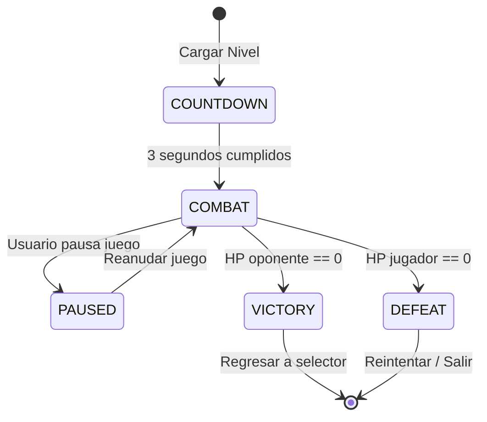
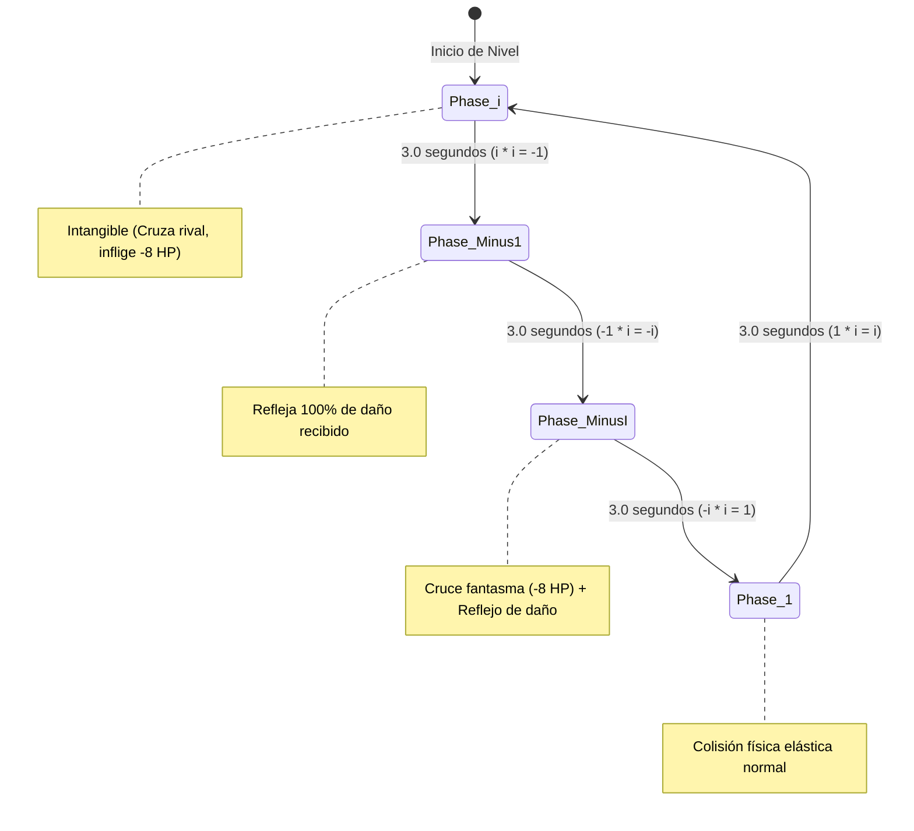
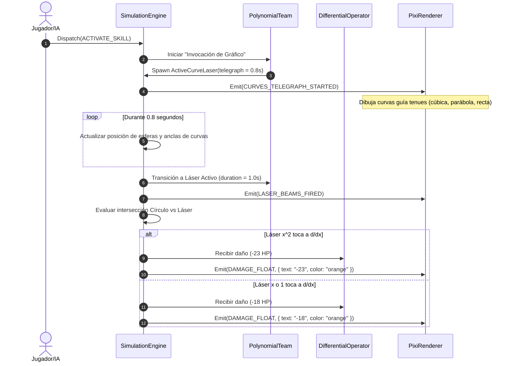
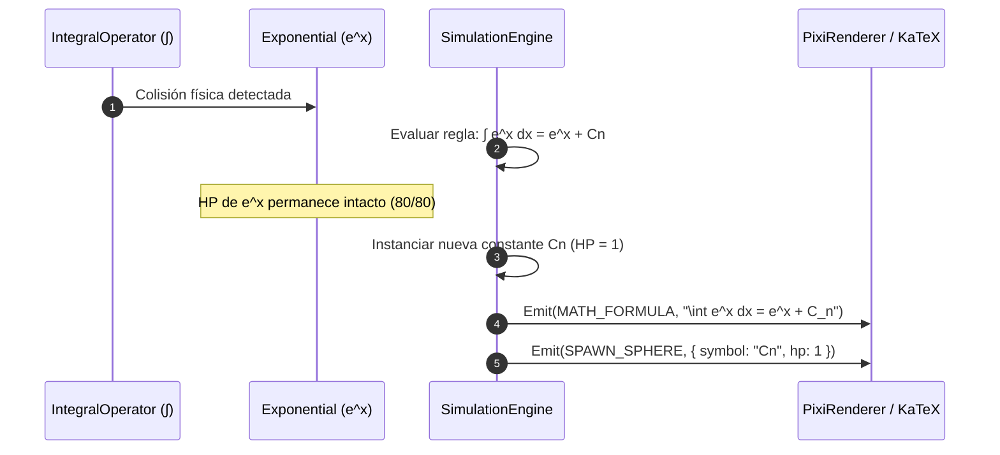

# Documento de Diseño Técnico: Math vs Math

**Cambio:** `initial-architecture-and-specs`  
**Autor:** Senior Software & Game Architect  
**Versión:** 1.0.0  
**Fecha:** Octubre 2026  
**Estado:** Aprobado para Implementación  

---

## 1. Visión y Contratos de Datos (Data Models)

### 1.1. Interfaces Principales del Dominio (TypeScript)

```typescript
// src/core/physics/Vector2D.ts
export interface Vector2D {
  readonly x: number;
  readonly y: number;
}

// src/core/entities/BaseEntity.ts
export type EntityCategory = 'OPERATOR' | 'POLYNOMIAL' | 'FUNCTION' | 'CONSTANT';

export interface EntityStateSnapshot {
  readonly id: string;
  readonly symbol: string;
  readonly category: EntityCategory;
  readonly position: Vector2D;
  readonly velocity: Vector2D;
  readonly radius: number;
  readonly hp: number;
  readonly maxHp: number;
  readonly cooldownRemaining: number;
  readonly cooldownMax: number;
  readonly statusEffects: ReadonlyArray<StatusEffect>;
  readonly currentPhase?: string;
  readonly currentEquation?: string;
  readonly isImmuneToDerivative: boolean;
}

export interface StatusEffect {
  readonly type: 'BURN' | 'INTANGIBLE' | 'REFLECT' | 'SHIELD';
  readonly durationRemaining: number;
  readonly tickDamage?: number;
  readonly tickInterval?: number;
}

// src/core/engine/SimulationEngine.ts
export type MatchStatus = 'COUNTDOWN' | 'COMBAT' | 'PAUSED' | 'VICTORY' | 'DEFEAT';

export interface WorldStateSnapshot {
  readonly tick: number;
  readonly status: MatchStatus;
  readonly countdownTimeRemaining: number;
  readonly leftEntity: EntityStateSnapshot;
  readonly rightEntity: EntityStateSnapshot;
  readonly subEntities: ReadonlyArray<EntityStateSnapshot>;
  readonly activeCurves: ReadonlyArray<ActiveCurveLaser>;
  readonly orbs: ReadonlyArray<PowerUpOrb>;
  readonly globalPolynomialHp?: { current: number; max: number };
}

export interface ActiveCurveLaser {
  readonly id: string;
  readonly ownerId: string;
  readonly curveType: 'CUBIC' | 'PARABOLA' | 'LINEAR' | 'HORIZONTAL' | 'EXPONENTIAL' | 'SINE' | 'COSINE' | 'SECTOR';
  readonly origin: Vector2D;
  readonly parameters: Record<string, number>;
  readonly telegraphRemaining: number;
  readonly isLaserActive: boolean;
  readonly durationRemaining: number;
}

export interface PowerUpOrb {
  readonly id: string;
  readonly type: 'AMPLITUDE_X2' | 'FREQUENCY_X2' | 'CONSTANT_1';
  readonly position: Vector2D;
  readonly radius: number;
}
```

---

## 2. Modelos Físicos y Algoritmos Analíticos de Intersección

### 2.1. Resolución de Colisión Elástica 2D entre Esferas
Dadas dos esferas $A$ y $B$ con radios $r_A, r_B$, posiciones $\vec{p}_A, \vec{p}_B$, masas $m_A, m_B$ y velocidades $\vec{v}_A, \vec{v}_B$:

1. **Detección:** Ocurre contacto si $\|\vec{p}_B - \vec{p}_A\| \le r_A + r_B$.
2. **Normal de Impacto:** $\vec{n} = \frac{\vec{p}_B - \vec{p}_A}{\|\vec{p}_B - \vec{p}_A\|}$.
3. **Velocidad Relativa:** $\vec{v}_{rel} = \vec{v}_B - \vec{v}_A$.
4. **Velocidad a lo largo de la normal:** $v_n = \vec{v}_{rel} \cdot \vec{n}$. Si $v_n > 0$, las esferas ya se están separando.
5. **Impulso Escalar Elástico ($e = 1.0$):**
   $$J = \frac{-(1 + e)(\vec{v}_{rel} \cdot \vec{n})}{\frac{1}{m_A} + \frac{1}{m_B}}$$
6. **Actualización de Velocidades:**
   $$\vec{v}'_A = \vec{v}_A - \frac{J}{m_A}\vec{n}, \quad \vec{v}'_B = \vec{v}_B + \frac{J}{m_B}\vec{n}$$
7. **Corrección de Penetración Geométrica:** Se desplazan las esferas a lo largo de $\vec{n}$ para separar la distancia interpenetrada y evitar *sticking*.

### 2.2. Algoritmo de Detección de Colisión Círculo vs. Curva Exponencial
Para una curva $y(x) = y_0 + e^{x - x_0}$ y un círculo con centro $(x_c, y_c)$ y radio $R$:
* Se muestrea analíticamente el segmento relevante $x \in [x_c - R, x_c + R]$ discretizado en $N = 16$ pasos.
* La distancia euclidiana mínima al arco de la curva se calcula como:
  $$d_{\min} = \min_{x_i} \sqrt{(x_i - x_c)^2 + (y(x_i) - y_c)^2}$$
* Si $d_{\min} \le R$, se produce impacto de la Cuchilla Exponencial.

---

## 3. Máquinas de Estado Finitas (FSM)

### 3.1. Ciclo de Vida de la Partida (Match Lifecycle FSM)



### 3.2. FSM de Rotación Cíclica de la Unidad Imaginaria ($i$)



---

## 4. Diagramas de Secuencia de Mecánicas Críticas

### 4.1. Invocación de Gráfico y Daño Láser (Polinomio vs. $\frac{d}{dx}$)



### 4.2. Colisión e Integración Indefinida ($\int$ vs. $e^x$)



---

## 5. Manejo de Errores y Casos Límite

1. **Prevención de Efecto Túnel (*Tunneling*):** A altas velocidades relativas, una esfera podría atravesar a otra o saltar la pared en un solo frame. El solucionador implementa *Continuous Collision Detection (CCD)* y limita la velocidad máxima a $V_{\max} = 0.4 \times \frac{R_{\min}}{\Delta t}$.
2. **División por Cero en Frecuencias:** En las entidades trigonométricas, la recarga depende de $T = \frac{2\pi}{b}$. Se restringe $b \ge 0.5$ mediante `Math.max(0.5, b)` para evitar períodos infinitos o división por cero.
3. **Pausas y Desincronización en Segundo Plano:** El acumulador de tiempo del bucle se recorta a un máximo de 250 ms (`MAX_ACCUMULATOR = 0.25 s`) para evitar congelamientos al regresar de otra pestaña.
